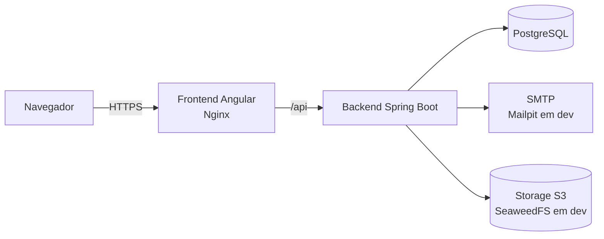

<div align="center">

# ClinicaViene

**Sistema de gestão para clínicas de saúde multiprofissionais**

Agenda · Pacientes · Anamnese · Prontuário · Financeiro · Documentos assinados

[](https://github.com/ericjunq/Clinica-Viene/actions/workflows/ci.yml)


</div>

---

## Sumário

- [Sobre o projeto](#sobre-o-projeto)
- [Funcionalidades](#funcionalidades)
- [Tecnologias](#tecnologias)
- [Arquitetura](#arquitetura)
- [Pré-requisitos](#pré-requisitos)
- [Começando](#começando)
  - [1. Clonar o repositório](#1-clonar-o-repositório)
  - [2. Configurar o ambiente (.env)](#2-configurar-o-ambiente-env)
  - [3. Rodar a aplicação](#3-rodar-a-aplicação)
  - [4. Primeiro acesso](#4-primeiro-acesso)
- [Serviços e portas](#serviços-e-portas)
- [Testes](#testes)
- [Estrutura do repositório](#estrutura-do-repositório)
- [Segurança e LGPD](#segurança-e-lgpd)
- [Documentação](#documentação)
- [Contribuindo](#contribuindo)
- [Roadmap](#roadmap)
- [Licença](#licença)

---

## Sobre o projeto

O **ClinicaViene** é o sistema de gestão da **Viene Odontologia & Saúde**. Ele cobre o dia a dia da clínica: recepção, cadastro de pacientes, anamnese preenchida e assinada pelo próprio paciente, agenda, prontuário, financeiro e documentos com assinatura eletrônica.

Hoje o foco é a **odontologia**, mas o modelo já é **multiprofissional**: áreas de atuação, conselhos profissionais (CRO, CRP, CRM…) e modelos de anamnese por área permitem incluir psicologia, medicina e outras especialidades sem reescrever o sistema.

Por lidar com dados de saúde, o projeto segue a **LGPD** como requisito de primeira classe: dados sensíveis cifrados, auditoria de toda leitura e alteração de dado de saúde e registros clínicos imutáveis.

## Funcionalidades

| Módulo | Situação |
| --- | --- |
| Login com senha + 2FA (aplicativo autenticador ou código por e-mail), códigos de recuperação | ✅ Concluído |
| Sessões com renovação rotativa, recuperação de senha, limite de tentativas | ✅ Concluído |
| Usuários e perfis (DEV, MASTER, ADMIN, PROFISSIONAL) com registro profissional | ✅ Concluído |
| Trilha de auditoria (somente inclusão) | ✅ Concluído |
| Cadastro de pacientes: busca, pré-cadastro, responsável legal, contato e histórico de alterações | ✅ Concluído |
| Termos LGPD versionados e consentimentos revogáveis (tela de configuração do MASTER) | ✅ Concluído |
| Modelos de ficha de saúde por área, com editor de perguntas (exemplo odontológico incluso) | ✅ Concluído |
| Convite de cadastro por link, QR code ou quiosque | ✅ Concluído |
| Fluxo público do paciente: confirmação por código ou quiosque, dados, ficha de saúde, privacidade | ✅ Concluído |
| Assinatura eletrônica da ficha (desenho ou nome), PDF com hash, storage cifrado e entrega por link + CPF | ✅ Concluído (provedor interno; cliente ZapSign pronto e desligado) |
| Entrega da ficha assinada pela recepção (QR na tela ou e-mail), sem a recepção abrir o PDF | ✅ Concluído |
| Agenda: consultórios, categorias, horários dos profissionais (fixos, extras, ausências), calendário e lista do dia, marcação com vários procedimentos, check-in com aviso em tempo real ao profissional e remarcação sem conflito | 🚧 Em andamento (falta semana do profissional e arrastar para remarcar) |
| Prontuário, financeiro, integrações | ⏳ Planejado |

O andamento detalhado fica em [`docs/CHECKLIST.md`](docs/CHECKLIST.md).

## Tecnologias

**Backend**
- Java 25 · Spring Boot 4.2 (Web MVC, Security, Data JPA, Validation, Mail, Actuator)
- Spring Security OAuth2 Resource Server (JWT RS256)
- PostgreSQL 18 · Flyway (migrations em SQL puro) · Hibernate 7 (`ddl-auto=validate`)
- Spring Modulith (registro de eventos) · Bucket4j (limite de tentativas) · ZXing (QR code)
- springdoc-openapi (Swagger UI em desenvolvimento)
- Testes: JUnit 5, Testcontainers, RestAssured, GreenMail, ArchUnit, JaCoCo

**Frontend**
- Angular 22 (standalone, zoneless) · Angular Material 22 (tema M3 com a identidade visual da Viene)
- Testes: Vitest (unitários) e Playwright (E2E) · ESLint · Prettier

**Infraestrutura**
- Docker e Docker Compose · Nginx (frontend em container)
- Mailpit (e-mails em desenvolvimento) · SeaweedFS (storage S3 em desenvolvimento)
- GitHub Actions (CI)

## Arquitetura



O backend é organizado em **camadas**, com os pacotes na raiz de `br.com.clinicaviene`:

```
br.com.clinicaviene/
├── controller/   endpoints REST (finos: convertem e delegam)
├── service/      regras de negócio e autorização
├── repository/   acesso a dados (Spring Data)
├── entity/       entidades JPA
├── dto/          requisições e respostas (records)
├── enums/        enums persistidos como texto
├── exceptions/   exceções e tratamento global (Problem Details)
├── auth/         segurança, JWT e permissões
├── config/       configurações e propriedades
├── util/         criptografia, CPF, tokens, QR code
└── validation/   validadores
```

As regras de uso do Lombok em entidades JPA são verificadas por testes ArchUnit.

## Pré-requisitos

| Para… | Você precisa de |
| --- | --- |
| Rodar tudo em containers | [Git](https://git-scm.com/) e [Docker](https://docs.docker.com/get-docker/) com Docker Compose v2 |
| Desenvolver o backend | JDK 25 (o Maven vem junto, via `./mvnw`) e Docker |
| Desenvolver o frontend | Node.js 24 e npm 11 |
| Gerar as chaves do `.env` | OpenSSL (já vem no Linux, macOS e Git Bash) |

## Começando

### 1. Clonar o repositório

```bash
git clone https://github.com/ericjunq/Clinica-Viene.git
cd Clinica-Viene
```

### 2. Configurar o ambiente (.env)

Todas as configurações locais ficam num arquivo `.env` na raiz, **fora do Git**. Crie-o a partir do modelo:

```bash
cp .env.example .env
```

Depois gere as chaves de criptografia e de assinatura de tokens. Sem elas o backend não inicia:

```bash
sed -i "s|^CRIPTO_CHAVES=.*|CRIPTO_CHAVES=v1:$(openssl rand -base64 32)|" .env
sed -i "s|^CPF_HMAC_CHAVE=.*|CPF_HMAC_CHAVE=$(openssl rand -base64 32)|" .env
sed -i "s|^JWT_CHAVE_PRIVADA=.*|JWT_CHAVE_PRIVADA=$(openssl genpkey -algorithm RSA -pkeyopt rsa_keygen_bits:2048 2>/dev/null | openssl pkcs8 -topk8 -nocrypt -outform DER | base64 -w0)|" .env
```

> No macOS, use `sed -i ''` no lugar de `sed -i` e `base64` sem o `-w0`.

Por fim, edite o `.env` e preencha:

- `POSTGRES_PASSWORD`: uma senha qualquer para o banco local;
- `DEV_INICIAL_*`: o primeiro usuário do sistema (veja [Primeiro acesso](#4-primeiro-acesso)).

| Variável | Para que serve |
| --- | --- |
| `POSTGRES_DB`, `POSTGRES_USER`, `POSTGRES_PASSWORD` | Banco de dados local |
| `CRIPTO_CHAVES`, `CRIPTO_CHAVE_ATIVA` | Chaves AES-256-GCM (versionadas) dos dados sensíveis |
| `CPF_HMAC_CHAVE` | Chave do HMAC usado para buscar CPF sem decifrar |
| `JWT_CHAVE_PRIVADA` | Chave RSA que assina o token de acesso |
| `APP_URL_PUBLICA` | Endereço do frontend usado nos links enviados aos pacientes |
| `S3_ENDPOINT`, `S3_BUCKET`, `S3_CHAVE_ACESSO`, `S3_CHAVE_SECRETA` | Storage dos documentos (PDFs vão cifrados); em dev, o SeaweedFS do compose |
| `ZAPSIGN_HABILITADO`, `ZAPSIGN_URL_API`, `ZAPSIGN_TOKEN` | Plataforma de assinatura ZapSign — **desligada** por padrão (`false`); a URL padrão é a do sandbox |
| `OPENAPI_HABILITADO` | Liga o Swagger UI (só em desenvolvimento) |
| `DEV_INICIAL_CPF`, `_NOME`, `_EMAIL`, `_SENHA` | Primeiro usuário, criado só com o banco vazio |
| `*_PORTA` | Portas expostas em `localhost` |

> ⚠️ **Nunca** commite o `.env`. Em produção, as chaves ficam num cofre, separadas do backup do banco: chave perdida significa dado cifrado irrecuperável.

### 3. Rodar a aplicação

#### Opção A: tudo em containers (mais simples)

Sobe banco, e-mail, storage, backend e frontend:

```bash
docker compose --profile app up -d --build
```

Acesse **http://localhost:4200**. Para acompanhar os logs e para encerrar:

```bash
docker compose --profile app logs -f backend
docker compose --profile app down        # adicione -v para apagar também os dados locais
```

#### Opção B: modo desenvolvimento (com recarga automática)

1. **Infraestrutura** (Postgres, Mailpit, SeaweedFS):

   ```bash
   docker compose up -d
   ```

2. **Backend**, em outro terminal (lê o `.env` da raiz automaticamente):

   ```bash
   cd backend
   ./mvnw spring-boot:run
   ```

   A API sobe em `http://localhost:8080`. Pela IDE, rode a classe `ClinicaVieneApplication` com `backend/` como diretório de trabalho.

3. **Frontend**, em outro terminal:

   ```bash
   cd frontend
   npm ci
   npm start
   ```

   Acesse **http://localhost:4200**. As chamadas a `/api` são encaminhadas ao backend pelo proxy do Angular.

### 4. Primeiro acesso

Na primeira subida, com o banco vazio, o backend cria o usuário **DEV** definido em `DEV_INICIAL_*`. Use um **CPF válido** (de teste) e uma senha com pelo menos 12 caracteres, incluindo letra maiúscula, letra minúscula e caractere especial.

1. Entre com o CPF e a senha provisória.
2. O sistema obriga a **trocar a senha** e a **configurar o 2FA** (aplicativo autenticador ou e-mail).
3. Guarde os **códigos de recuperação** exibidos.
4. Crie o usuário **MASTER** (responsável pela clínica) e, depois, remova as linhas `DEV_INICIAL_*` do `.env`.
5. Entre como MASTER e, em **Configurações**, carregue os textos de exemplo, revise e **publique** a política de privacidade e uma **ficha de saúde** (sem elas, o paciente não consegue concluir o cadastro).
6. Em **Pacientes**, faça o pré-cadastro e gere o convite: link/QR para o celular do paciente ou **quiosque** num aparelho da clínica.

Em desenvolvimento, os e-mails (códigos, convites) **não saem para a internet**: abra o Mailpit em http://localhost:8025 para vê-los.

## Serviços e portas

Todas as portas escutam apenas em `127.0.0.1`.

| Serviço | Endereço | Observação |
| --- | --- | --- |
| Frontend | http://localhost:4200 | |
| Backend (API) | http://localhost:8080/api/v1 | |
| Swagger UI | http://localhost:8080/swagger-ui.html | Com `OPENAPI_HABILITADO=true` |
| Health check | http://localhost:8080/actuator/health | |
| Mailpit | http://localhost:8025 | Caixa de entrada de desenvolvimento |
| PostgreSQL | `localhost:5432` | Credenciais do `.env` |
| SeaweedFS (S3) | http://localhost:8333 | Storage de desenvolvimento |

## Testes

O **GitHub Actions é o lugar oficial dos testes**: uma mudança só é considerada aprovada com o CI verde. O pipeline ([`.github/workflows/ci.yml`](.github/workflows/ci.yml)) roda a cada push:

| Job | O que faz |
| --- | --- |
| Backend | Testes unitários e de integração (Testcontainers) e cobertura mínima (JaCoCo) |
| Frontend | Lint, formatação, testes unitários e build de produção |
| Docker | Valida o `compose.yaml` e monta as imagens |
| E2E | Sobe o ambiente completo e roda os testes de navegador (Playwright) |

Para rodar localmente:

```bash
# Backend (requer Docker para o Testcontainers)
cd backend
./mvnw test        # unitários (*Test)
./mvnw verify      # unitários + integração (*IT) + verificação de cobertura

# Sem JDK instalado, usando Docker (a partir de backend/)
docker run --rm -v "$PWD":/app -v /var/run/docker.sock:/var/run/docker.sock \
  -w /app maven:3-eclipse-temurin-25 ./mvnw verify

# Frontend
cd frontend
npm test                 # unitários (Vitest)
npm run lint             # ESLint
npm run format:check     # Prettier

# E2E (com o ambiente completo no ar — Opção A)
E2E_DEV_CPF=<cpf> E2E_DEV_SENHA=<senha> npx playwright test
```

Os testes E2E precisam de um **banco novo**: o projeto `primeiro-acesso` cria os usuários (DEV → MASTER fictícia) e o projeto `fluxos` depende dele (cadastro do paciente pelo quiosque, assinatura e download do PDF).

Os relatórios de teste e de cobertura ficam disponíveis como artefatos de cada execução do CI.

## Estrutura do repositório

```
Clinica-Viene/
├── backend/                 API Spring Boot (Maven)
│   ├── src/main/java/       código-fonte (br.com.clinicaviene)
│   ├── src/main/resources/
│   │   ├── db/migration/    migrations Flyway (SQL)
│   │   └── exemplos/        textos-exemplo de termos e anamnese
│   └── src/test/            testes unitários (*Test) e de integração (*IT)
├── frontend/                aplicação Angular
│   ├── src/app/             core, layout, páginas e componentes compartilhados
│   └── e2e/                 testes Playwright
├── docs/                    documentação de produto e decisões
├── .github/workflows/       pipeline de CI
├── compose.yaml             ambiente de desenvolvimento
└── .env.example             modelo de configuração (valores fictícios)
```

## Segurança e LGPD

- **Dados sensíveis cifrados** com AES-256-GCM e chaves versionadas; o CPF também ganha um HMAC-SHA256 para unicidade e busca sem decifrar.
- **Auditoria** de toda leitura e alteração de dado de saúde, numa tabela que o próprio banco impede de alterar ou apagar.
- **Registros clínicos imutáveis**: prontuário, anamnese, termos aceitos e documentos assinados não sofrem `UPDATE` nem `DELETE`; correções entram como adendo ou nova versão, garantido por *triggers* no banco.
- **Autenticação forte**: senha com política mínima, 2FA obrigatório, token de acesso curto em memória, renovação em cookie `HttpOnly` com rotação e detecção de reuso.
- **Permissões verificadas a cada requisição**, a partir do perfil atual no banco (não do token).
- **Limite de tentativas** em login, códigos e reenvios de e-mail.
- **Nenhum segredo nem dado real de paciente** no repositório ou fora de produção.

Encontrou uma vulnerabilidade? **Não abra uma issue pública.** Entre em contato diretamente com o mantenedor do repositório.

## Documentação

A pasta [`docs/`](docs/) é a fonte da verdade do projeto:

| Documento | Conteúdo |
| --- | --- |
| [`CONTEXTO.md`](docs/CONTEXTO.md) | Objetivos, regras de negócio, LGPD, modelo de dados e arquitetura |
| [`DECISOES.md`](docs/DECISOES.md) | Decisões aceitas, recusadas e a confirmar, com data e motivo |
| [`CHECKLIST.md`](docs/CHECKLIST.md) | O que está feito, em andamento e pendente, por fase |
| [`DUVIDAS.md`](docs/DUVIDAS.md) | Dúvidas em aberto |

Com o backend no ar e `OPENAPI_HABILITADO=true`, a documentação interativa da API fica no Swagger UI.

## Contribuindo

- O trabalho é feito **direto na branch `main`**, em commits pequenos, um por implementação ou alteração.
- Mensagens de commit seguem `tipo: descrição`, em português, no imperativo e em minúsculas. Tipos: `feat`, `fix`, `refactor`, `test`, `docs`, `chore`, `ci`, `build`, `perf`, `style`. Exemplo: `feat: adiciona cadastro de consultórios`.
- Toda funcionalidade vem com testes, e toda mudança de regra atualiza a documentação em `docs/` no mesmo conjunto de commits.
- O schema do banco muda **somente por migrations Flyway**.
- Depois do push, acompanhe o CI; CI vermelho na `main` é corrigido antes de qualquer outra coisa.

As regras completas de código, testes e banco estão em [`CLAUDE.md`](CLAUDE.md) e em [`docs/CONTEXTO.md`](docs/CONTEXTO.md).

## Roadmap

- [x] **Fase 0**: fundação do repositório, CI e ambiente Docker
- [x] **Fase 1**: identidade, 2FA, usuários, auditoria e telas de acesso
- [x] **Fase 2**: pacientes, termos LGPD, anamnese e assinatura *(código concluído; aguardando revisão dos textos e o teste real da ZapSign)*
- [ ] **Fase 3**: agenda *(em andamento)*
- [ ] **Fase 4**: prontuário
- [ ] **Fase 5**: financeiro
- [ ] **Fase 6**: documentos e assinaturas
- [ ] **Fase 7**: integrações
- [ ] **Fase 8**: entrega contínua e implantação

## Licença

Software proprietário. Todos os direitos reservados. Nenhuma licença de uso, cópia ou distribuição é concedida sem autorização expressa do titular.
